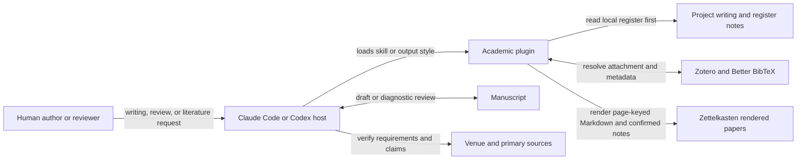

# denubis-academic — Context (Level 0)

> System boundary: scholarly writing and review procedures, a continuous academic
> output style, and Zotero-to-Markdown helpers for source-grounded literature work.

## Context

## What the plugin ships

| Component | Responsibility |
|---|---|
| `literature-scout` skill | Searches scholarly indexes, traces citations, and separates candidate discovery from metadata verification through a read-only standard-library helper. |
| `annotated-bibliography` skill | Drafts source-grounded entries against the existing resolved cache, checks literal evidence spans, and keeps interpretation review and OCR visual checks separate. |
| `academic-writing` skill | Loads project register notes before drafting or revising, then applies the portable prose and revision discipline (`plugins/denubis-academic/skills/academic-writing/SKILL.md`, `8dae417`). |
| `paper-review` skill | Selects relevant review facets, orders them by evidence dependency, and keeps defects, concerns, competing readings, and uncertainty distinct (`plugins/denubis-academic/skills/paper-review/SKILL.md`). |
| `using-bibliography` skill | Routes Zotero resolution, rendering, source-fidelity checks, confirmed writes, bibliography refresh, notes, and installation recovery (`plugins/denubis-academic/skills/using-bibliography/SKILL.md`). |
| Prose-shape helper | `prose_shape.py` describes a Markdown manuscript's shape for the author's deletion test: histograms of sentence length, commas per sentence and sentences per paragraph; the lengths in order; and every coordinated series, foil, stacked hedge, passive, section announcement and sentence-initial -ing word with its sentence. It carries no thresholds; a register note's `toml prose-shape` block or command-line flags supply them, and without either only distributions and structural shapes are reported. spaCy's English transformer pipeline by default (`plugins/denubis-academic/skills/academic-writing/prose_shape.py`, 0.20.0). |
| `Academic Writing` output style | Holds the portable prose register continuously while retaining coding instructions (`plugins/denubis-academic/output-styles/academic-writing.md`, `8dae417`). |
| Bibliography helpers | `resolve.py` is the front door; `ingest.py` handles DOI batches; `render.py` owns the render cascade and writes the extraction record (`extraction`, `forced`, `limitations`, render version 3); `blockquote.py` locates a quotation in a render; `collection.py --list` lists a collection with trashed rows marked; the write helpers (`item_collections.py`, `trash_item.py`, `create_item.py`, `collection.py --create/--rename/--trash/--restore`, `register_export.py`, and the older `fetch.py`, `copy_item.py`, `update_item.py`, `annotate.py`) preview, protect the state they depend on, and report `accepted` and `verified` separately (`plugins/denubis-academic/skills/using-bibliography/`, design `docs/design-plans/2026-10-12-bibliography-0.19-scan-detection-and-zotero-crud.md`, ADR 0029). |

## External boundaries

| Entity | Contract |
|---|---|
| Project `.notes/` | Project-specific register and writing rules override the portable floor after the procedure opens them. |
| Zotero and Better BibTeX | Own bibliographic records, citekeys, attachment resolution, and registered project exports. On Zotero 10 the plugin files, trashes, restores, creates, and renames items and collections through Zotero's stock local API (PATCH and POST only; delete means trash, never `DELETE`; ADR 0029) and registers auto-exports through BBT's `autoexport.add`. The plugin does not silently create, copy, repair, annotate, fetch, or trash corpus items. |
| `zotero-api-plus` | Optionally exposes capability-probed copy, fetch, repair, annotation, and forced-export endpoints, and the `/api/plus/libraries` listing every write helper uses to resolve library and collection names (so the stock-API helpers require it too). Every user-data mutation is previewed and confirmed. |
| Zettelkasten | Stores rendered paper text by resolved citekey for source inspection. |
| Venue guidance | Supplies current submission requirements. The review procedure verifies current official guidance when the project has no dated copy. |
| Human | Owns authorial intent, durable register approval, and acceptance of manuscript changes. |

## Boundary and failure modes

- The output style supplies continuous prose guidance. It does not perform the
  `academic-writing` skill's note-loading or revision workflow.
- A diagnostic review discusses the manuscript; it does not silently edit it.
- Rendered Markdown supports source inspection and locates passages; it is never
  exact-quotation authority on its own, whatever the extraction record says. A
  quotation is `located` by a render match and `verified` only after the physical
  source page (PDF page image, or the snapshot or attachment for non-PDF sources)
  has been checked; `meta.json` describes extraction and its limitations as advice.
- A Zotero write is `accepted` when Zotero or BBT took the request and `verified`
  only when the helper read the effect back; the two are reported separately, and a
  helper never prints a bare success.
- Installed helpers resolve Codex's `PLUGIN_ROOT` or Claude Code's
  `CLAUDE_PLUGIN_ROOT` and do not depend on a developer checkout or caller working
  directory. Executable portability tests exercise both provider environments and their
  precedence.
- Missing Zotero, configuration, attachment, renderer, or zettelkasten preconditions
  block only the literature operation that depends on them.
- A project register can override the portable writing floor. The session must read it;
  a one-line project summary is not a substitute.

## Cross-references

- **Plugin manifests:** `plugins/denubis-academic/.claude-plugin/plugin.json` and
  `plugins/denubis-academic/.codex-plugin/plugin.json`.
- **Bundled bibliography:** `plugins/denubis-academic/references.bib` (`42a3287`).
- **Cross-cutting instruction control:** [`../../instruction-control/0-context.md`](../../instruction-control/0-context.md).
